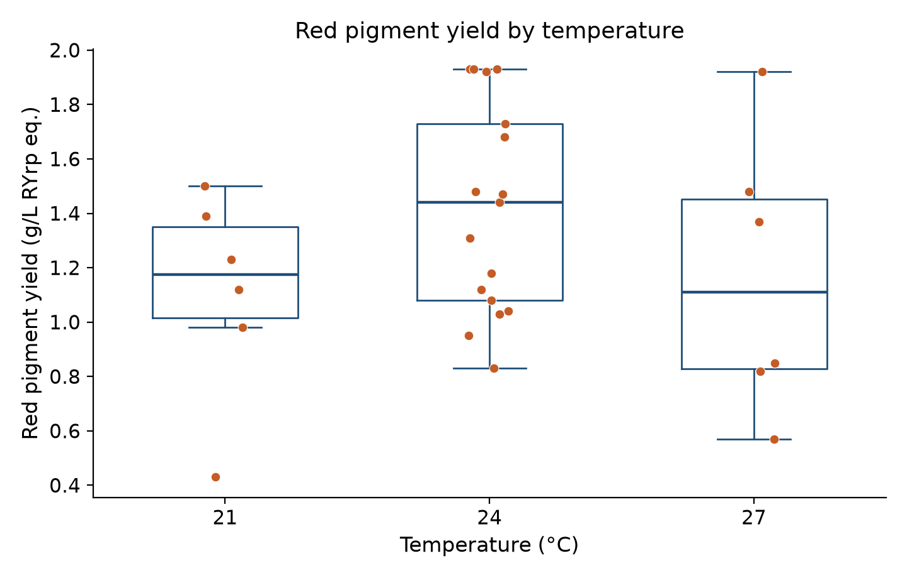
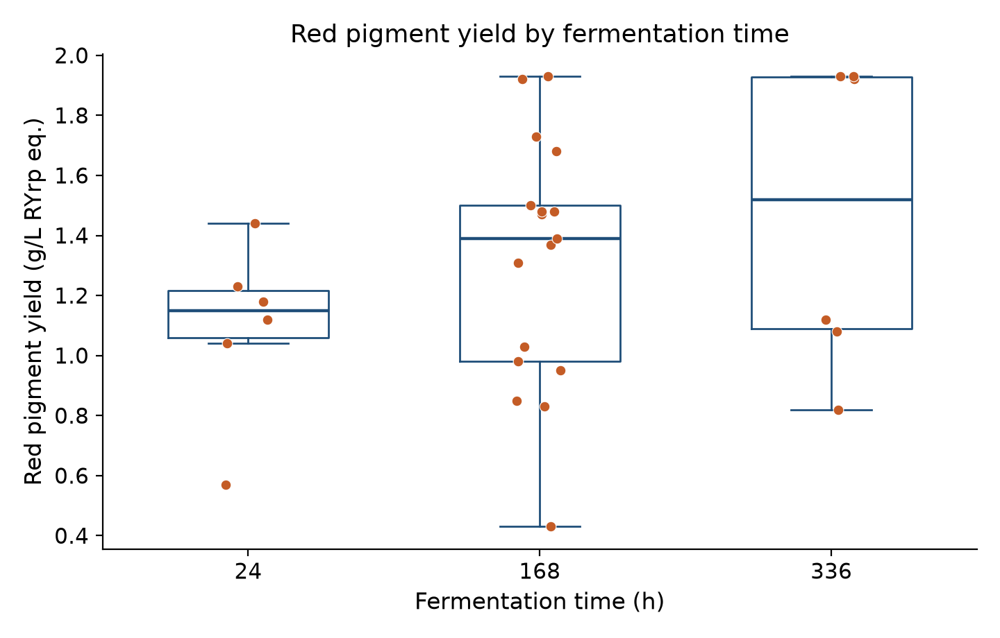
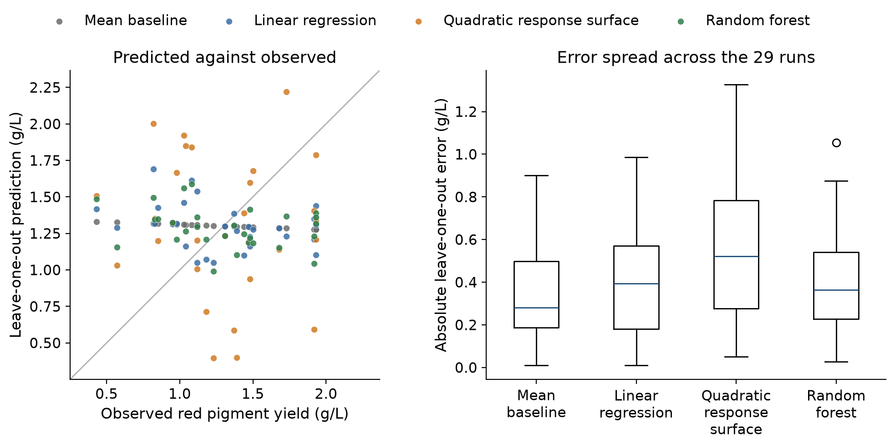

# Bioprocess Yield Optimization ML

[](LICENSE)


How do fermentation process parameters (initial pH, temperature, agitation, fermentation time) relate to red pigment yield, and can a simple model predict yield from them?

## Data

`data/venkatachalam_2020_table2.csv` is Table 2 of Venkatachalam, Shum-Chéong-Sing, Dufossé, and Fouillaud, *Microorganisms* 2020, 8, 711 ([doi:10.3390/microorganisms8050711](https://doi.org/10.3390/microorganisms8050711), CC BY 4.0). It records 29 shake-flask fermentations of *Talaromyces albobiverticillius* 30548 (GenBank [MK937814](https://www.ncbi.nlm.nih.gov/nuccore/MK937814)) in potato dextrose broth, laid out as a four-factor Box–Behnken design with five center points. Factor columns in the article are coded (−1, 0, +1). Actual setpoints below are decoded from Table 1 of the same paper. Details are in `data/PROVENANCE.txt`.

| Column | Unit |
|---|---|
| ph | initial pH (4, 6.5, or 9) |
| temperature_c | °C (21, 24, or 27) |
| agitation_rpm | rpm (100, 150, or 200) |
| fermentation_time_h | h (24, 168, or 336) |
| orange_pigment_yield_g_l | g/L quinizarin equivalent at 470 nm |
| red_pigment_yield_g_l | g/L red yeast rice pigment equivalent at 500 nm (target) |
| biomass_g_l | g/L dry biomass |

Aeration rate and substrate concentration were not varied. Orange pigment and biomass are co-measured outcomes, so they are not used as predictors.

An earlier file in this repository, `data/bioprocess_dataset.csv`, was a 12-row table with no stated source. It has been removed. The hold-out scores previously reported for that file (MAE 0.336, R² 0.716 from `test_size=0.25`, three test rows) are not results of this analysis.

## Methods

1. Exploratory plots of red pigment yield against temperature and fermentation time (`src/visualization.py`).
2. Summary of the design and the runs that reach the highest red pigment yield (`src/yield_analysis.py`).
3. Prediction of red pigment yield from the four coded setpoints (`src/model_training.py`):
   - **Mean baseline:** predict the training-fold mean.
   - **Linear regression** and a **quadratic response surface** (main effects, squares, and two-factor interactions) on the coded factors.
   - **Random forest:** 200 trees, `min_samples_leaf=2`, all four factors considered at each split, `random_state=42`. These settings were fixed in advance and were not chosen by searching the cross-validation score.
4. Error is estimated by leave-one-out cross-validation (29 held-out runs) and by repeated 5-fold cross-validation (10 repeats, `random_state=42`). Spread is the sample standard deviation (n−1) of absolute leave-one-out errors, and of MAE and R² across the 10 repeats.

## Results

Red pigment yield on the 29 runs is 1.300 ± 0.418 g/L (mean ± SD), from 0.43 to 1.93 g/L. The five center-point replicates alone are 1.248 ± 0.355 g/L. Three different setpoints share the printed maximum of 1.93 g/L (runs 27, 28, and 29), so the table does not identify a unique best condition.





Leave-one-out scores, rounded to three decimals. Full precision is in `results/model_performance.csv`.

| Model | MAE (g/L) | RMSE | R² | Absolute-error SD | Absolute-error range |
|---|---:|---:|---:|---:|---:|
| Mean baseline | 0.355 | 0.426 | −0.073 | 0.238 | 0.010–0.901 |
| Random forest | 0.400 | 0.469 | −0.304 | 0.249 | 0.028–1.055 |
| Linear regression | 0.406 | 0.481 | −0.368 | 0.262 | 0.010–0.986 |
| Quadratic response surface | 0.550 | 0.649 | −1.492 | 0.350 | 0.051–1.327 |

Repeated 5-fold cross-validation (mean ± SD over 10 repeats):

| Model | MAE (g/L) | R² |
|---|---:|---:|
| Mean baseline | 0.354 ± 0.005 | −0.076 ± 0.035 |
| Random forest | 0.387 ± 0.026 | −0.271 ± 0.132 |
| Linear regression | 0.407 ± 0.026 | −0.389 ± 0.176 |
| Quadratic response surface | 0.660 ± 0.116 | −2.675 ± 1.125 |

The mean baseline has the lowest error on both procedures. R² below zero means the predictions are worse than always predicting the grand mean. The center-point SD (0.355 g/L) is already as large as the baseline MAE, so the printed table does not support a stable ranking of process settings beyond that scatter.

A least-squares quadratic fit to Table 2, using every term, has an in-sample R² of 0.492 and predicts 1.248 g/L at the design center (`results/quadratic_insample_check.csv`). Equation (9) of the article has intercept 1.92, and the article reports an in-sample R² of 0.9734 for red pigment. Those article figures are not reproduced from the printed table and are not used as results here.

## Reproduce

```bash
python -m pip install -r requirements.txt
python src/yield_analysis.py          # writes results/yield_summary.csv
python src/model_training.py          # writes results/model_performance.csv
python src/visualization.py           # writes figures/
```

Development checks:

```bash
python -m pip install -r requirements.txt -r requirements-dev.txt
python -m ruff check src tests
python -m pytest
```

Or open `notebooks/bioprocess_yield_analysis.ipynb` from the repository root. It calls the same functions.

## Limitations

- Twenty-nine design points from one strain and one medium. Aeration and substrate were not factors.
- Run 14 lists an orange pigment yield of −0.10 g/L as printed. That value is kept. The red-pigment target for the same run is 0.43 g/L.
- The five center replicates disagree by several tenths of a gram per litre. Models cannot beat that noise on this table.
- The quadratic surface has 15 coefficients and 29 rows. Leave-one-out shows that the in-sample fit does not predict a held-out run.
- Table 2, as printed, does not recover Equation (9). The cross-validated numbers above describe the transcribed table only.

## Next steps

- Compare Table 2 with the original design file, or with the triplicate measurements, before treating Equation (9) as a description of these rows.
- For batch trajectories rather than a four-factor flask design, use a larger public fermentation set such as IndPenSim (Goldrick et al., *Journal of Biotechnology* 2015 and *Computers & Chemical Engineering* 2019; [Mendeley Data doi:10.17632/pdnjz7zz5x.1](https://doi.org/10.17632/pdnjz7zz5x.1)).

## Citation

Data: Venkatachalam M, Shum-Chéong-Sing A, Dufossé L, Fouillaud M. Statistical Optimization of the Physico-Chemical Parameters for Pigment Production in Submerged Fermentation of *Talaromyces albobiverticillius* 30548. *Microorganisms*. 2020;8(5):711. https://doi.org/10.3390/microorganisms8050711

Software: see [CITATION.cff](CITATION.cff).

## Author

Ishitta Sarkar · [ORCID](https://orcid.org/0009-0008-1028-6010) · [MIT License](LICENSE)
